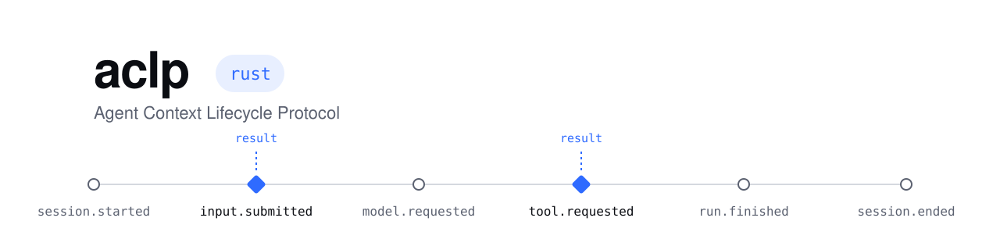

<h1 align="center">
  <picture>
    <source media="(prefers-color-scheme: dark)" srcset=".github/assets/banner-dark.svg">
    
  </picture>
</h1>

<p align="center">
  <a href="https://crates.io/crates/aclp"></a>
  <a href="https://docs.rs/aclp"></a>
  <a href="https://github.com/superaligned-to/aclp-rs/actions/workflows/check.yml"></a>
  <a href="https://github.com/superaligned-to/aclp"></a>
  <a href="LICENSE"></a>
</p>

Rust client and callback server for the [Agent Context Lifecycle Protocol](https://github.com/superaligned-to/aclp). The client sends typed lifecycle events to local or remote servers over HTTP or HTTPS; the server validates them, runs your callbacks and checks their results against a JSON Schema.

```toml
[dependencies]
aclp = "0.1"
```

## Example

```rust
use std::convert::Infallible;

use aclp::events::{ContentBlock, InputSubmittedParams};
use aclp::{Callbacks, Client, ClientOptions, ResultSchema, Server, ServerOptions};
use serde::{Deserialize, Serialize};
use serde_json::json;

#[derive(Serialize, Deserialize)]
struct ContextReply {
    context: Vec<String>,
}

#[tokio::main]
async fn main() -> Result<(), Box<dyn std::error::Error>> {
    let context = ResultSchema::<ContextReply>::new(json!({
        "type": "object",
        "properties": { "context": { "type": "array", "items": { "type": "string" } } },
        "required": ["context"],
        "additionalProperties": false,
    }))?;

    let callbacks = Callbacks::new().request(&context, |input: InputSubmittedParams| async move {
        let class = input
            .content
            .iter()
            .any(|block| matches!(block, ContentBlock::Text { text } if text.contains("class")));

        let context = if class {
            vec!["Prefer plain structs and free functions.".to_owned()]
        } else {
            Vec::new()
        };

        Ok::<_, Infallible>(ContextReply { context })
    });

    let listener = tokio::net::TcpListener::bind("127.0.0.1:8787").await?;

    let server = Server::new(callbacks, ServerOptions::new())?;

    tokio::spawn(server.serve(listener, std::future::pending()));

    let client = Client::new(ClientOptions::new("http://127.0.0.1:8787/events"))?;

    let input = InputSubmittedParams {
        session_id: "session-1".to_owned(),
        run_id: None,
        agent_id: None,
        content: vec![ContentBlock::Text { text: "Create a Rust class.".to_owned() }],
        structured_content: None,
    };

    let reply = client.request(&input, &context).await?;

    assert_eq!(reply.context, ["Prefer plain structs and free functions."]);
    Ok(())
}
```

Notifications use `client.notify(&params)` and `client.flush().await`. A runnable example with both delivery paths and shutdown:

```sh
cargo run -p aclp --example context-and-errors
```

## Development

```sh
cargo xtask check
```

Licensed under [MIT](LICENSE).
